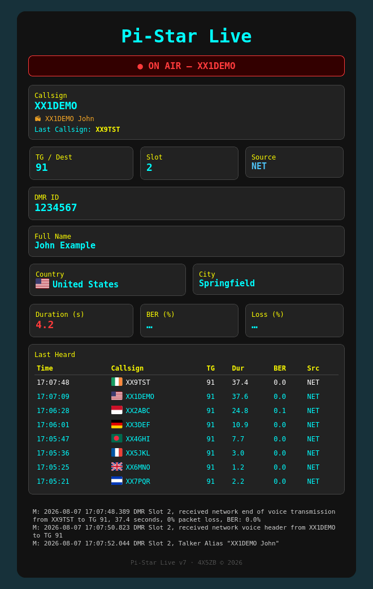

# Pi-Star Real-Time Interface by 4X5ZB

A mobile-friendly, retro-style live dashboard for **Pi-Star** that displays real-time DMR activity: live calls, callsign info, signal quality, Talker Alias, country flags, and a Last Heard table.



---

## ✨ Features (v8)

- 📡 **DMR & YSF (System Fusion) support** — parses both log formats automatically
- 🔴 **ON AIR indicator** — blinking banner showing who is transmitting right now
- ⏱️ **Live TX timer** — running duration counter during an active transmission; final duration, BER and packet loss shown when it ends
- 📻 **Talker Alias** — station name decoded directly from the DMR stream (instant, no internet lookup needed)
- 🌍 **Country flags** — resolved from RadioID data or callsign prefix (~100 prefixes), rendered as images so they work on **all** operating systems including Windows
- 🕐 **Local time at the speaker's QTH** — live ticking clock in the transmitting station's timezone
- 🌡️ **Local temperature & weather** — current conditions at the speaker's city with weather emoji (via the free Open-Meteo API, no key required)
- 📋 **Last Heard table** — the last 8 transmissions with time, callsign + flag, TG, duration, BER and source
- 🔵 **NET / RF source indicator** — color-coded network vs. local RF traffic
- 👤 **Station info** — DMR ID, full name, country and city via RadioID.net
- 🔒 **Built-in CORS proxy with caching** — the Pi queries RadioID.net server-side; results are cached on the Pi (7 days) *and* in the browser, so the API is never hammered
- 📶 **Connection watchdog** — the dashboard dims automatically if the log feed is lost
- 📱 Fully responsive — designed for phone screens

---

## 📦 Files Included

| File | Purpose |
|------|---------|
| `pi_star_interface_v8.html` | The main live dashboard |
| `live_log.php` | Backend: streams the MMDVM log **and** proxies RadioID lookups with caching |
| `interface_preview.png` | Screenshot of the interface |

---

## 🚀 Installation

### 1. Requirements

- A working Pi-Star device with SSH enabled
- [WinSCP](https://winscp.net/eng/download.php) (or any SCP client) for file transfer
- SSH terminal access (Windows CMD, PuTTY, etc.)

### 2. Steps

1. **Download the repository as a ZIP** and extract the contents.
2. **Open CMD** and connect to Pi-Star:

   ```
   ssh pi-star@pi-star.local
   ```

3. **Authenticate** (default password: `raspberry`)
4. **Enable write access**:

   ```
   rpi-rw
   ```

5. **Use WinSCP** to connect to `pi-star.local` via SCP and upload `live_log.php` and `pi_star_interface_v8.html` into `/home/pi-star/`
6. **Back in the SSH terminal**, move the files:

   ```
   sudo mv /home/pi-star/pi_star_interface_v8.html /var/www/dashboard/
   sudo mv /home/pi-star/live_log.php /var/www/dashboard/
   ```

7. **Open the dashboard** in your browser:

   ```
   http://pi-star.local/pi_star_interface_v8.html
   ```

   > 💡 Works via direct IP too (e.g. `http://192.168.1.50/pi_star_interface_v8.html`) — all URLs are relative.

---

## 🔧 How It Works

- The page polls `live_log.php` every 3 seconds, which tails the latest `/var/log/pi-star/MMDVM-*.log`.
- Voice **headers** drive the live display (callsign, TG, slot, source); voice **end-of-transmission** lines provide duration, BER and packet loss.
- Talker Alias frames are parsed straight from the log and cached per callsign.
- Local time & weather: the city from RadioID is geocoded via Open-Meteo (coordinates + timezone), the clock ticks client-side, and current temperature is fetched with a 10-minute cache. Open-Meteo supports CORS so the browser calls it directly - free, no API key.
- Station lookups go through `live_log.php?mode=lookup&callsign=X` — the Pi fetches from RadioID.net and caches the JSON in `/tmp/dmr_lookup_cache/` for 7 days. This avoids browser CORS restrictions entirely.

---

## 📜 Changelog

**v8.1** *(2026-08)*
- YSF (System Fusion) support — RF/network headers, end-of-transmission, watchdog close
- Fixed possible duplicate rows in Last Heard on quiet hotspots

**v8** *(2026-08)*
- Local time at the speaker's QTH (live ticking clock, timezone via Open-Meteo geocoding)
- Current temperature + weather emoji at the speaker's city (Open-Meteo, cached 10 min)
- City disambiguation by ISO country code (e.g. Springfield AU vs. US)

**v7** *(2026-08)*
- Talker Alias decoding + display (also used as name fallback)
- Live running TX timer; stale quality stats no longer shown during active TX
- Country flags (RadioID country or callsign-prefix fallback), image-based for Windows compatibility
- Last Heard table (8 entries) with flags, duration, BER, source
- ON AIR / STANDBY banner, NET/RF indicator, Slot display
- Server-side RadioID proxy with 7-day cache (fixes CORS + empty station info)
- Correct BER / packet-loss parsing from end-of-transmission lines
- Handles late entry, `/P` `/M` suffixes, private calls, network watchdog timeouts
- Relative URLs (works via hostname or IP), stale-connection dimming

**v5**
- Initial public release: live call display with RadioID lookup

---

## 📡 Created by: Kfir — 4X5ZB

Feel free to connect via DMR or leave a comment!

## 📜 License

This project is open under the [MIT License](https://opensource.org/licenses/MIT).

## ☕ Support This Project

I've put a lot of time and passion into building this Pi-Star live interface for the ham radio community.
If you found it useful and would like to support further development, consider buying me a coffee 💙

[](https://www.paypal.me/MonkeDeLofi)
